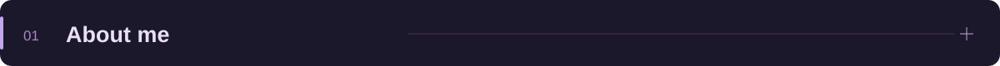
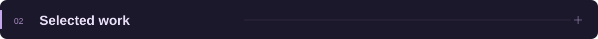
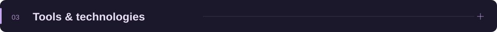

  
  &nbsp;
  

 

<h2></h2>

I'm a <b>Computer Engineering graduate</b> interested in web and mobile development, data analytics, and machine learning.

Through my internships, I gained hands-on experience with <b>ASP.NET Core MVC, Python, and React Native</b>. I'm currently developing <b>Animio</b>, a pet care mobile application, and <b>ReviewLens</b>, a customer feedback analytics application.

I enjoy building practical projects that connect <b>user-friendly interfaces, backend services, and data-driven insights</b>.

 

<h2></h2>

<table>
<tr>
<td width="50%" valign="top"></td>
<td width="50%" valign="top"></td>
</tr>
<tr>
<td valign="top">
A mobile application combining <b>pet care management</b> with AI-assisted support.

Rule-based risk assessment and contextual guidance through the <b>OpenAI API</b>.
</td>
<td valign="top">
A feedback analytics application being developed to turn customer reviews into <b>actionable insights</b>.

Designed for review exploration, <b>sentiment analysis</b>, and interactive visual reporting.
</td>
</tr>
<tr>
<td valign="top">React Native · TypeScript · Node.js · Express.js Firebase · Cloud Firestore · OpenAI API</td>
<td valign="top">Python · FastAPI · React TypeScript · REST API</td>
</tr>
<tr>
<td><a href="https://github.com/selinkubra/Animio"><b>View Animio ↗</b></a></td>
<td><a href="https://github.com/selinWorks/reviewlens-feedback-analytics"><b>View ReviewLens ↗</b></a></td>
</tr>
</table>

 

<h2></h2>

Technologies I use across my projects and learning.

<h4>Languages</h4>

<table><tr>
<td align="center" width="100"> C#</td>
<td align="center" width="100"> Python</td>
<td align="center" width="100"> TypeScript</td>
<td align="center" width="100"> JavaScript</td>
</tr></table>

<h4>Web &amp; Mobile</h4>

<table><tr>
<td align="center" width="100"> React / React Native</td>
<td align="center" width="100"> Next.js</td>
<td align="center" width="100"> Tailwind CSS</td>
</tr></table>

<h4>Backend</h4>

<table><tr>
<td align="center" width="100"> ASP.NET Core</td>
<td align="center" width="100"> FastAPI</td>
<td align="center" width="100"> Flask</td>
<td align="center" width="100"> Node.js</td>
<td align="center" width="100"> Express.js</td>
</tr></table>

<h4>Data &amp; Tools</h4>

<table><tr>
<td align="center" width="100"> SQL Server</td>
<td align="center" width="100"> MySQL</td>
<td align="center" width="100"> Firebase</td>
<td align="center" width="100"> Git</td>
<td align="center" width="100"> GitHub</td>
</tr></table>

 

<h2></h2>

Let's connect to talk about web development, mobile applications, and data.

