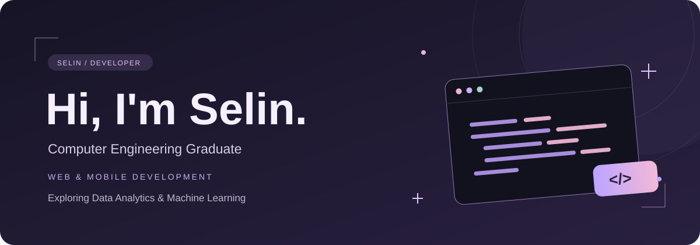
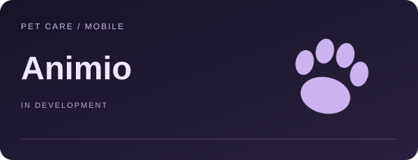
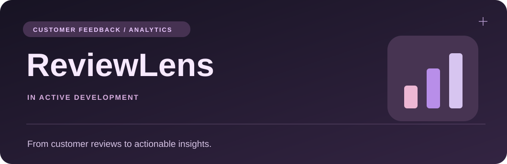
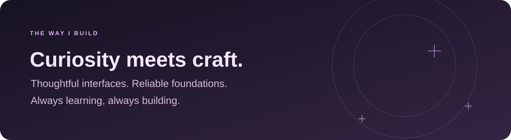
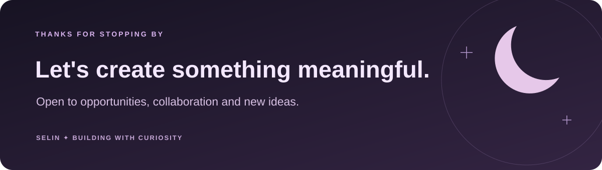

<!-- Lavender After Dark · GitHub Profile -->

  

  

  
  &nbsp;
  

 

## ✦ About me

<table>
<tr>
<td width="59%" valign="middle">

I'm a **Computer Engineering graduate** interested in building practical, intuitive digital products across **web, mobile, and data**.

During my internships, I worked with **ASP.NET Core MVC, Python, and React Native**, gaining experience across different parts of the development process.

Currently, I'm building **Animio**, a pet care mobile application, and **ReviewLens**, a customer feedback analytics platform.

I enjoy bringing together thoughtful interfaces, reliable backend services, and meaningful insights.

</td>
<td width="41%" align="center" valign="middle">

</td>
</tr>
</table>

 

## ✦ Currently building

<table>
<tr>
<td width="50%" valign="top">

 
<b>Animio · Pet Care Mobile App</b>
  
A mobile application for managing everyday pet care, featuring AI-assisted support, rule-based risk assessment, and contextual guidance through the OpenAI API.
  
<b>Stack:</b> React Native · TypeScript · Node.js · Express.js · Firebase · OpenAI API
  
<a href="https://github.com/selinkubra/Animio"><b>Explore project ↗</b></a>
</td>
<td width="50%" valign="top">

 
<b>ReviewLens · Customer Feedback Analytics</b>
  
A full-stack application in development to explore customer reviews, analyze sentiment, surface recurring themes, and present insights through interactive visualizations.
  
<b>Stack:</b> Python · FastAPI · React · TypeScript · REST API
  
<a href="https://github.com/selinWorks/reviewlens-feedback-analytics"><b>Explore project ↗</b></a>
</td>
</tr>
</table>

 

## ✦ My toolkit

Technologies I've used in projects, internships, and ongoing learning.

<table>
<tr><td width="50%" valign="top"><b>⌘ Languages</b>  
 C# · Python · TypeScript · JavaScript</td>
<td width="50%" valign="top"><b>◈ Web & Mobile</b>  
 React · React Native · Next.js · Tailwind CSS</td></tr>
<tr><td valign="top"><b>⚙ Backend</b>  
 ASP.NET Core · FastAPI · Flask · Node.js · Express</td>
<td valign="top"><b>◇ Data & Tools</b>  
 SQL Server · MySQL · Firebase · Git · GitHub</td></tr>
</table>

 

## ✦ Beyond the code

 

## ✦ GitHub activity

Statistics are generated by a third-party service and reflect public GitHub data.

 

## ✦ Let's connect

&nbsp;

✦ Designed with curiosity and a little lavender ✦

