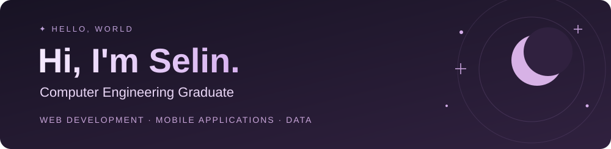

<!-- Selin | GitHub Profile -->

  

  

  
  &nbsp;
  

## ✦ About me

I'm a **Computer Engineering graduate** who enjoys creating thoughtful digital experiences, from mobile interfaces to backend services.

- 💻 Building with **React Native, React, TypeScript and Python**.
- 🌷 Internship experience with **ASP.NET Core MVC, Python and React Native**.
- 📊 Exploring **data analytics and machine learning**.
- 🛠️ Currently developing **Animio** and **ReviewLens**.

I like projects that combine practical problem-solving, intuitive design and meaningful data.

 

## ✦ Tech stack

**Languages**

**Web & mobile**

React · React Native · Next.js · Tailwind CSS

**Backend**

**Data & tools**

SQL Server · MySQL · Firebase · Git · GitHub

## ✦ Featured projects

### 🐾 [Animio](https://github.com/selinkubra/Animio) · Pet Care Mobile App

A pet care application in development, combining everyday care management with **AI-assisted support**, rule-based risk assessment and contextual guidance.

`React Native` `TypeScript` `Node.js` `Express.js` `Firebase` `OpenAI API`

### 📈 [ReviewLens](https://github.com/selinWorks/reviewlens-feedback-analytics) · Customer Feedback Analytics

A full-stack application in development for **review exploration, sentiment analysis** and interactive visual reporting, designed to turn customer feedback into useful insights.

`Python` `FastAPI` `React` `TypeScript` `REST API`

## ✦ GitHub activity

  
  

Statistics are provided by a third-party service and reflect public repository activity.

## ✦ Let's connect

Always happy to connect with people interested in **web development, mobile applications and data-driven projects**.

  
  &nbsp;
  

